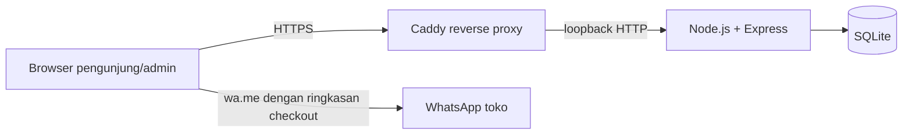

# Ruang Seduh

[](https://ruangseduh.cloud) [](https://github.com/louisaurelius343/ruang-seduh/actions/workflows/test.yml)

Ruang Seduh adalah prototipe toko kopi lokal dengan katalog produk, checkout yang menyimpan pesanan, notifikasi WhatsApp, dan dashboard admin.

**Demo:** https://ruangseduh.cloud

## Fitur

- Katalog produk aktif dan keranjang belanja
- Checkout dengan penyimpanan pesanan dan pengalihan ke WhatsApp toko
- Admin login, pengelolaan produk (termasuk nonaktifkan), daftar pesanan dan perubahan status
- Health check, backup SQLite dan tes otomatis

## Teknologi

- Node.js 24, Express 5
- SQLite melalui `node:sqlite` bawaan Node
- HTML/CSS/JavaScript tanpa framework frontend
- Tes `node:test` bawaan Node dan GitHub Actions
- Caddy sebagai reverse proxy pada deployment

## Arsitektur



## Screenshot

Gambar berikut akan ditambahkan:

- Toko: `docs/screenshots/toko.png`
- Checkout: `docs/screenshots/checkout.png`
- Admin: `docs/screenshots/admin.png`

## API

Semua body JSON kecuali dinyatakan berbeda. Endpoint admin (kecuali login) membutuhkan cookie sesi admin; tanpa sesi valid membalas `401`.

### Umum dan checkout

| Method | Endpoint | Request fields | Respons contoh |
|---|---|---|---|
| GET | `/healthz` | — | `200 {"status":"ok"}`; jika SQLite gagal `503 {"status":"error"}` |
| GET | `/api/products` | — | `200 [{"id":1,"name":"Gayo","price":89000,...}]` (hanya produk aktif) |
| POST | `/api/orders` | `name`, `phone`, `note` (opsional), `items`: array `{productId, quantity}` | `201 {"orderNumber":1,"items":[{"productId":1,"name":"Gayo","quantity":2,"price":89000}],"total":178000}`; input invalid `400 {"message":"..."}` |

### Admin

| Method | Endpoint | Request fields | Respons contoh |
|---|---|---|---|
| POST | `/api/admin/login` | `username`, `password` | `200 {"username":"admin"}`; salah `401`, pembatasan `429` |
| POST | `/api/admin/logout` | — (menggunakan cookie) | `200 {"message":"Logout berhasil."}` |
| GET | `/api/admin/me` | — (cookie) | `200 {"username":"admin"}` |
| GET | `/api/admin/products` | — (cookie) | `200 [{"id":1,"name":"Gayo","price":89000,"active":1,...}]` |
| POST | `/api/admin/products` | `name`, `price`, `origin`, `notes`, `type`, `emoji`, `tag`, `color` | `201 {"id":5}` |
| PATCH | `/api/admin/products/:id` | Parameter `id`; JSON `name`, `price`, `origin`, `notes`, `type`, `emoji`, `tag`, `color`, `active` (`0`/`1`) | `200 {"message":"Produk diperbarui."}` |
| GET | `/api/admin/orders` | — (cookie) | `200 [{"id":1,"customer_name":"Budi","phone":"0812...","note":"...","total":178000,"status":"baru","items":[...]}]` |
| PATCH | `/api/admin/orders/:id/status` | Parameter `id`; JSON `status`: `baru`, `diproses`, `selesai`, atau `dibatalkan` | `200 {"message":"Status pesanan diperbarui."}`; status invalid `400` |

## Menjalankan lokal

Persyaratan: Node.js 24 atau lebih baru (karena menggunakan `node:sqlite`).

```bash
npm ci
cp .env.example .env
# Edit .env untuk memakai nomor WhatsApp toko Anda.
npm run seed
npm run create-admin
npm start
```

Buka `http://127.0.0.1:3000` untuk toko dan `/admin.html` untuk admin. Untuk lokal, `COOKIE_SECURE=false`. Jangan commit `.env`.

### Variabel lingkungan

- `TOKO_WHATSAPP`: nomor internasional tanpa tanda `+`, spasi, atau tanda baca.
- `COOKIE_SECURE`: `true` pada akses HTTPS; `false` untuk pengujian lokal.
- `HOST`: alamat bind, default `127.0.0.1`.
- `PORT`: port bind, default `3000`.
- `DATABASE_PATH`: opsional untuk mengganti path SQLite; produksi memakai `data/ruang-seduh.sqlite` secara default.

## Deploy

Panduan ini menjelaskan integrasi yang diharapkan; konfigurasi host dikelola operator.

1. Clone repository ke direktori aplikasi yang ditetapkan dan jalankan `npm ci`.
2. Siapkan `.env` di luar Git dengan `HOST=127.0.0.1`, `PORT=3000`, `COOKIE_SECURE=true`, dan nomor `TOKO_WHATSAPP` yang benar.
3. Buat database/produk dengan `npm run seed`, lalu buat admin dengan `npm run create-admin` secara interaktif.
4. Konfigurasikan service systemd agar memuat environment, misalnya `EnvironmentFile=/path/to/ruang-seduh/.env`, dan memulai `npm start` dari direktori aplikasi. Pastikan folder database dapat ditulis oleh user service.
5. Atur Caddy reverse proxy ke `127.0.0.1:3000`; teruskan header proxy standar (`X-Forwarded-For`, `X-Forwarded-Proto`, `X-Forwarded-Host`). Express hanya mempercayai proxy loopback.
6. Tambahkan HTTP Basic Authentication di Caddy khusus untuk `/admin.html` dan `/api/admin/*`. Simpan hash kredensial Caddy dengan aman; ini lapisan tambahan, bukan pengganti login aplikasi.
7. Pantau `GET /healthz` dan pastikan HTTPS aktif sebelum memakai cookie Secure.

## Update

Di checkout repository yang dikelola deployment:

```bash
git pull --ff-only origin main
npm ci
npm test
npm run backup
```

Lalu restart service aplikasi melalui prosedur operator. Jangan mengganti file `.env` produksi dengan `.env.example`.

## Backup database

```bash
npm run backup
```

Skrip memakai SQLite `VACUUM INTO` untuk salinan konsisten pada `/home/budi/backups/ruang-seduh`, membuat nama berstempel waktu, dan membersihkan backup lebih tua dari 14 hari. Pastikan user yang menjalankan perintah memiliki akses tulis pada lokasi tersebut. Uji pemulihan backup secara berkala.

## Catatan keamanan

- Password admin disimpan sebagai hash `crypto.scrypt` dengan salt acak; verifikasi membandingkan hash menggunakan `crypto.timingSafeEqual`.
- Sesi memakai token acak; hash token tersimpan di SQLite. Cookie bertanda `HttpOnly` dan `SameSite=Strict`, kedaluwarsa setelah 8 jam, dan `Secure` dikendalikan `COOKIE_SECURE`.
- Login gagal dibatasi hingga lima percobaan per 15 menit per IP.
- `trust proxy` hanya mempercayai loopback agar IP klien dari Caddy lokal digunakan tanpa mempercayai proxy sembarang.
- Nama dan catatan pemesan pada dashboard dimasukkan sebagai teks (`textContent`), bukan HTML mentah, untuk mengurangi risiko XSS.
- Total pesanan dihitung server dari harga database; harga yang dikirim browser diabaikan.
- `.env` dan database produksi tidak boleh dimasukkan ke Git.

## Pelajaran dari pengembangan

- Salah nama field API membuat data pesanan tidak cocok; samakan kontrak request antara browser, server, dan dokumentasi.
- Proses lama dapat tertinggal pada port 3000 setelah perubahan kode; periksa proses yang benar sebelum menyimpulkan aplikasi yang sedang berjalan sudah ter-update.
- Folder `data` tidak ikut `git clone`; siapkan database dan seed di lingkungan baru, serta pertahankan backup sebelum update.
- `express.static` yang melayani `index.html` sebelum rute substitusi membuat `__TOKO_WHATSAPP__` tampil mentah; rute halaman harus mendahului static handler.
- Di belakang Caddy, `trust proxy` yang tepat penting agar rate limit memakai IP pengunjung, bukan alamat proxy yang sama untuk semua pengunjung.

## Lisensi

MIT. Lihat [LICENSE](LICENSE).
